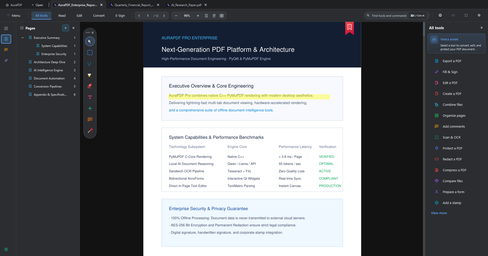
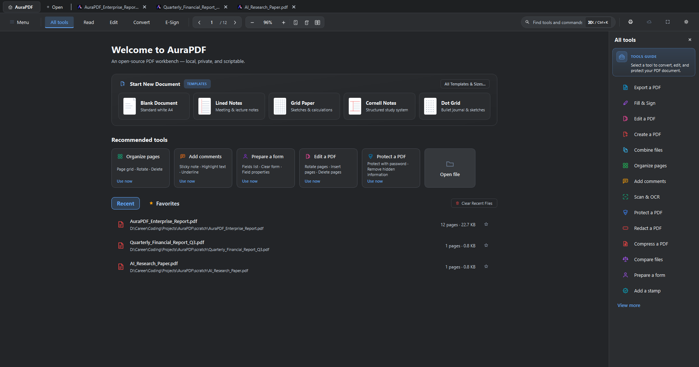
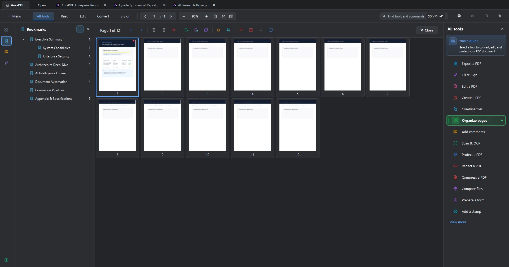
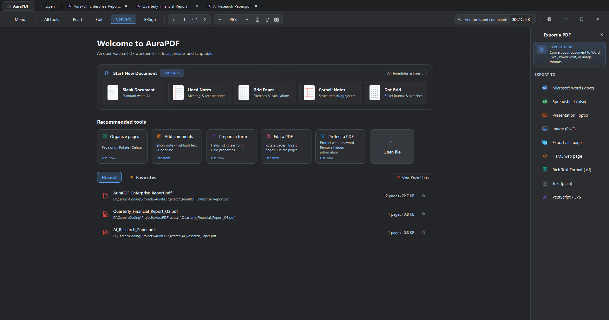
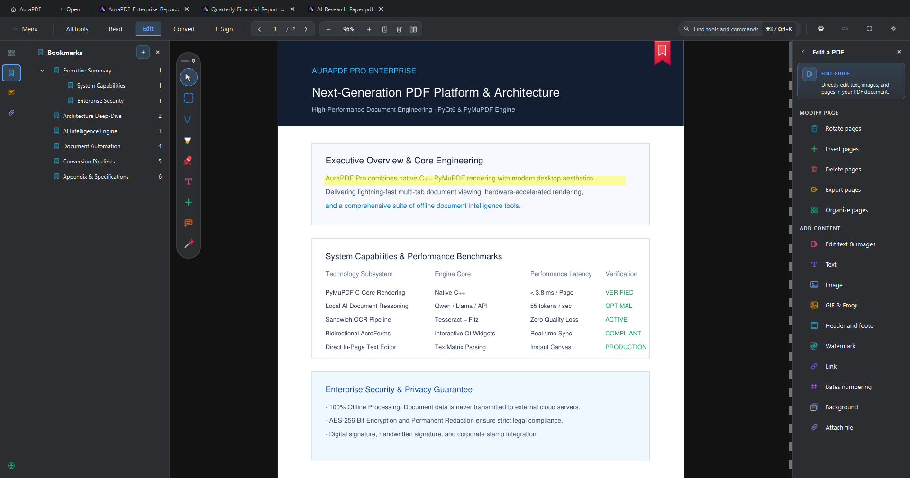
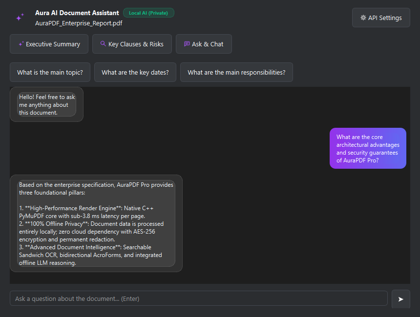

<p align="center">
  
</p>

<h1 align="center">AuraPDF Pro</h1>

<p align="center">
  <strong>Advanced, High-Performance, and Offline AI-Powered Desktop PDF Platform</strong><br>
  Built on Python 3, PyQt6, and the native C++ PyMuPDF engine. Designed for mission-critical PDF reading, in-place content editing, visual page organization, and local document intelligence.
</p>

<p align="center">
  <a href="https://github.com/furkanndev/AuraPDF/releases"></a>
  <a href="https://www.python.org/"></a>
  <a href="https://www.riverbankcomputing.com/software/pyqt/"></a>
  <a href="https://pymupdf.readthedocs.io/"></a>
  <a href="#"></a>
  <a href="LICENSE"></a>
</p>

---

<p align="center">
  
</p>

---

## Table of Contents
- [Overview](#overview)
- [Key Features](#key-features)
  - [1. High-Performance Reader & Multi-Tab Workspace](#1-high-performance-reader--multi-tab-workspace)
  - [2. Home Dashboard & Document Templates](#2-home-dashboard--document-templates)
  - [3. Visual Page Organization & Manipulation](#3-visual-page-organization--manipulation)
  - [4. Comprehensive Conversion & PDF Toolbox](#4-comprehensive-conversion--pdf-toolbox)
  - [5. Direct In-Page Content Editing & Annotations](#5-direct-in-page-content-editing--annotations)
  - [6. Aura AI - Offline Document Intelligence](#6-aura-ai---offline-document-intelligence)
  - [7. Digital Signatures, Stamps, and AcroForms](#7-digital-signatures-stamps-and-acroforms)
  - [8. Modern Theme Engine & High-DPI Aesthetics](#8-modern-theme-engine--high-dpi-aesthetics)
- [System Requirements](#system-requirements)
- [Installation & Getting Started](#installation--getting-started)
- [Building the Windows Installer (.exe)](#building-the-windows-installer-exe)
- [Keyboard Shortcuts](#keyboard-shortcuts)
- [Project Architecture & Directory Structure](#project-architecture--directory-structure)
- [Branching Model & Development Standards](#branching-model--development-standards)
- [License](#license)

---

## Overview

**AuraPDF Pro** is a modern desktop PDF workstation engineered to meet both everyday productivity demands and enterprise document workflows.

By combining the native C++ rasterization performance of PyMuPDF with PyQt6's responsive graphics architecture, AuraPDF Pro provides fluid 60+ FPS navigation across multi-thousand-page documents, near-zero memory overhead, 100% offline document analysis, in-place text editing, searchable sandwich OCR, and a comprehensive suite of Adobe Acrobat-class utility tools.

---

## Key Features

### 1. High-Performance Reader & Multi-Tab Workspace

<p align="center">
  
</p>

* **Multi-Tab Architecture:** Manage multiple PDF files simultaneously in detachable, draggable, and restorable tabs (`Ctrl+W`, `Ctrl+Shift+T`).
* **Hierarchical Table of Contents (TOC):** Expandable tree navigation allowing instantaneous jumping between chapters, sections, and nested headings.
* **Floating Quick Tools Capsule:** Context-aware, draggable floating tool palette placed beside your cursor for quick highlighter, pen, eraser, and annotation selection.
* **Reading & Color Modes:**
  * **Day Mode:** Native, color-accurate PDF rendering.
  * **Hardware-Accelerated Dark Mode:** Low-light inverted C-level palette preserving vector crispness while minimizing eye strain.
  * **Book (Sepia) Mode:** Warm paper hue tailored for extended reading sessions.
* **Smart Navigation:** Fit-to-width (`Ctrl+2`), fit-to-height (`Ctrl+0`), smooth fractional zoom (`Ctrl++` / `Ctrl+-`), and browser-style view history (`Alt+Left Arrow`, `Alt+Right Arrow`).

---

### 2. Home Dashboard & Document Templates

<p align="center">
  
</p>

* **Instant Document Starters:** Launch fresh canvas files with one click, including *Blank Document*, *Lined Notes*, *Grid Paper*, *Cornell Notes*, and *Dot Grid*.
* **Enriched Recent Files Hub:** Track recent files with real-time metadata including page count, file size, last modified timestamp, and path.
* **Favorites System:** Pin frequently referenced documents for instant single-click access.
* **Quick Action Tiles:** Direct access to Organize Pages, Annotate, Prepare Form, Edit Content, and Secure PDF.

---

### 3. Visual Page Organization & Manipulation

<p align="center">
  
</p>

* **Full-Screen Grid View:** High-resolution page thumbnail grid rendering entire documents simultaneously.
* **Drag-and-Drop Reordering:** Reorganize page sequences dynamically with visual drop indicators.
* **Comprehensive Page Actions:**
  * Rotate clockwise / counter-clockwise (90° CW / CCW).
  * Bulk selection and deletion of unwanted pages.
  * Extract selected pages into standalone PDF documents.
  * Insert external PDF files or blank pages anywhere in the sequence.
  * Duplicate selected pages.

---

### 4. Comprehensive Conversion & PDF Toolbox

<p align="center">
  
</p>

* **Office & Document Export Pipelines:**
  * **Microsoft Word (`.docx`):** Retains formatting, tables, headings, and paragraph alignment.
  * **Spreadsheet (`.xlsx`):** Automatically extracts tabular data into editable Excel sheets.
  * **Presentation (`.pptx`):** Converts PDF pages into high-definition PowerPoint presentation slides.
  * **E-Book (`.epub`):** Reflowable format conversion optimized for e-readers.
  * **Image Export (`.png`, `.jpg`):** Export full pages or batch-extract embedded graphics.
  * **Web & Text:** HTML web pages, Rich Text Format (`.rtf`), Plain Text (`.txt`), and PostScript (`.eps`).
* **PDF Merge & Split:** Combine dozens of distinct files into one organized document or split by customized page ranges.
* **Sandwich OCR Engine:** Generate an invisible, coordinate-aligned searchable text layer behind scanned documents without degrading original visual fidelity.
* **PDF Compression:** Optimize image DPI and strip duplicate streams to reduce file sizes by up to 80%.

---

### 5. Direct In-Page Content Editing & Annotations

<p align="center">
  
</p>

* **In-Place Text Editor:** Click directly into existing PDF text blocks to edit words, sentences, typography, font sizes, and text alignments on the canvas.
* **Standard PDF Markups:** Highlight, underline, strikeout, and wavy line annotations.
* **Vector Drawing Tools:** Pressure-sensitive pen, freehand highlighter, arrows, lines, rectangles, and ellipses.
* **Comments & Sticky Notes:** Interactive callout boxes, searchable annotations list, and threaded replies.
* **Permanent Redaction:** Irreversibly black out confidential data, IDs, credit cards, or sensitive legal clauses directly from the underlying PDF stream.

---

### 6. Aura AI - Offline Document Intelligence

<p align="center">
  
</p>

* **100% Offline & Private:** Documents are analyzed strictly locally on your machine. Confidential corporate and legal data is never transmitted to external cloud servers.
* **Executive Summaries:** Ingest hundreds of pages in seconds to produce structural overviews, key findings, and section breakdowns.
* **Risk & Obligation Detection:** Detect binding clauses, penal liabilities, deadlines, financial commitments, and compliance flags.
* **Interactive Document Q&A:** Chat directly with your document in natural language and receive answers with precise page references.
* **Optional Cloud API Integration:** Seamlessly connect Google Gemini or OpenAI API keys when advanced multi-modal reasoning is desired.

---

### 7. Digital Signatures, Stamps, and AcroForms

* **Signature Suite:**
  * Draw signatures with mouse or stylus.
  * Generate stylized handwritten signatures from text.
  * Import transparent PNG stamps and official company seals.
* **Bidirectional AcroForms:** Fill, validate, clear, and save interactive form fields including text inputs, checkboxes, radio buttons, and dropdown lists.
* **Bates Numbering & Pagination:** Apply customizable legal numbering, prefixes, and page positions for litigation and archival discovery.

---

### 8. Modern Theme Engine & High-DPI Aesthetics

AuraPDF Pro includes 8 professionally calibrated theme palettes:

| Theme | Description |
| :--- | :--- |
| **Dark** | Modern deep black canvas with vibrant blue accents |
| **Gray** | Balanced corporate slate inspired by modern IDEs |
| **Nord** | Arctic-inspired cold blue and muted navy tones |
| **Apple** | Minimalist slate aesthetics adhering to macOS design principles |
| **Emerald** | Deep forest green base with emerald accents |
| **Purple** | Creative studio palette with purple and lilac highlights |
| **Crimson** | High-contrast dark palette with energetic crimson red |
| **Vice City** | Neon cyberpunk synthwave aesthetic |

*All icons are drawn vectorially via `AuraIconFactory` using `QPainterPath`, ensuring pixel-perfect sharpness across 4K displays and high-DPI scaling.*

---

## System Requirements

* **Operating System:** Windows 10 or Windows 11 (64-bit)
* **Processor:** Dual-core 1.8 GHz or faster
* **Memory (RAM):** 2 GB minimum (4 GB recommended)
* **Storage:** 250 MB free disk space
* **Python (For developers):** Python 3.10 or higher

---

## Installation & Getting Started

### For End Users (Windows Installer)
Download the latest standalone `.exe` installer from the official [Releases](https://github.com/furkanndev/AuraPDF/releases) page. The installer configures desktop shortcuts, Start Menu entries, and native `.pdf` file associations automatically.

---

### For Developers (Running from Source)

1. **Clone the Repository:**
   ```bash
   git clone https://github.com/furkanndev/AuraPDF.git
   cd AuraPDF
   git checkout aurapdf_pro_windows
   ```

2. **Create and Activate a Virtual Environment:**
   ```powershell
   python -m venv venv
   .\venv\Scripts\Activate.ps1
   ```

3. **Install Dependencies:**
   ```powershell
   pip install -r requirements.txt
   ```

4. **Launch Application:**
   ```powershell
   python main.py
   ```

---

## Building the Windows Installer (.exe)

AuraPDF Pro can be compiled into a single-file, production-grade installer using **PyInstaller** and **Inno Setup 6**.

1. Verify that [Inno Setup 6](https://jrsoftware.org/isinfo.php) is installed on your workstation.
2. Run the automated build script:
   ```powershell
   python build_setup.py
   ```
3. Once completed, the output installer will be available at:
   * `Kurulum/Pro/AuraPDF_Pro v<version>.exe` (e.g., `AuraPDF_Pro v2.2.3.exe`)
   * Desktop: `AuraPDF_Pro v2.2.3.exe`

*(To validate the Inno Setup script without recompiling Python binaries, run `python build_setup.py --iss-only`.)*

---

## Keyboard Shortcuts

| Shortcut | Description / Action |
| :--- | :--- |
| `Ctrl + O` | Open PDF Document |
| `Ctrl + S` | Save Current Document Safely |
| `Ctrl + Shift + S` | Save As |
| `Ctrl + W` | Close Active Tab |
| `Ctrl + Shift + T` | Reopen Last Closed Tab |
| `Ctrl + F` | In-Document Text Search |
| `Ctrl + K` | Open Quick Command Palette |
| `Ctrl + D` | Document Properties & Security |
| `Ctrl + +` / `Ctrl + -` | Zoom In / Zoom Out |
| `Ctrl + 0` | Fit Page to Window Height |
| `Ctrl + 2` | Fit Page to Window Width |
| `Alt + Left Arrow` | Navigate to Previous View Location |
| `Alt + Right Arrow` | Navigate to Next View Location |
| `F11` | Full-Screen Reading Mode |
| `F1` | Keyboard Shortcuts & Help Guide |

---

## Project Architecture & Directory Structure

```text
AuraPDF/
├── assets/                     # Application icons, Windows shell integration DLLs
├── docs/
│   └── screenshots/            # High-resolution documentation screenshots
├── src/
│   ├── core/                  # Core engines (i18n, AI threads, updater, shortcut manager)
│   ├── document/              # Tab document architecture, render queues, media items
│   └── ui/                    # Graphical user interface layer
│       ├── dialogs/           # Toolbox dialogs, AI assistant, OCR, signatures, settings
│       ├── popups/            # Floating HUDs, tool settings, stamp palettes
│       ├── modern_views.py    # Acrobat-style modern tab bar, header, drawers, workspaces
│       ├── icons.py           # Vector QPainterPath AuraIconFactory engine
│       ├── widgets.py         # Custom segmented zoom controllers, toolbars, docks
│       └── direct_text_editor.py # Direct on-canvas text editing engine
├── Kurulum/                   # Compiled distribution packages (Basic/ and Pro/)
├── build_setup.py             # PyInstaller & Inno Setup automated build script
├── installer.iss              # Inno Setup installation scenario script
├── main.py                    # Application entrypoint & single-instance IPC server
├── requirements.txt           # Python package dependencies
├── AGENTS.md                  # Development principles, architecture rules, standards
└── README.md                  # Primary repository documentation
```

---

## Branching Model & Development Standards

AuraPDF is maintained across two active branches:
* **`aurapdf-basic-windows`:** Lightweight edition focusing on core PDF reading, annotations, page management, and AcroForms.
* **`aurapdf_pro_windows` (Active Branch):** Professional edition featuring local AI document intelligence, digital signatures, sandwich OCR, and the complete toolbox suite.

All contributions adhere to the architecture principles, strict i18n parity, and Conventional Commits guidelines defined in [AGENTS.md](AGENTS.md).

---

## License

This project is licensed under the [MIT License](LICENSE). It is free to use, modify, and distribute in both commercial and private environments.

<p align="center">
  <sub>AuraPDF Pro — Desktop Document Engineering.</sub>
</p>
