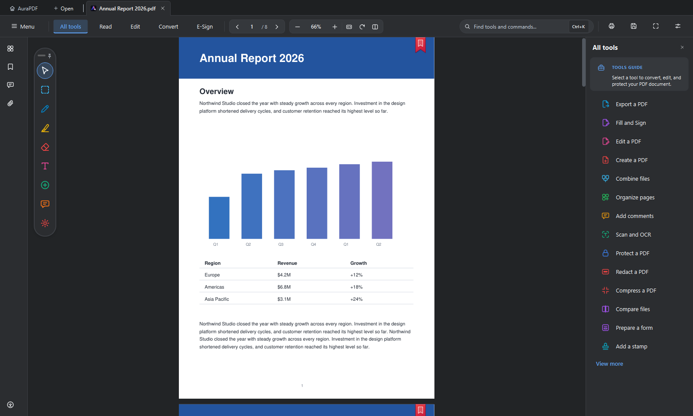
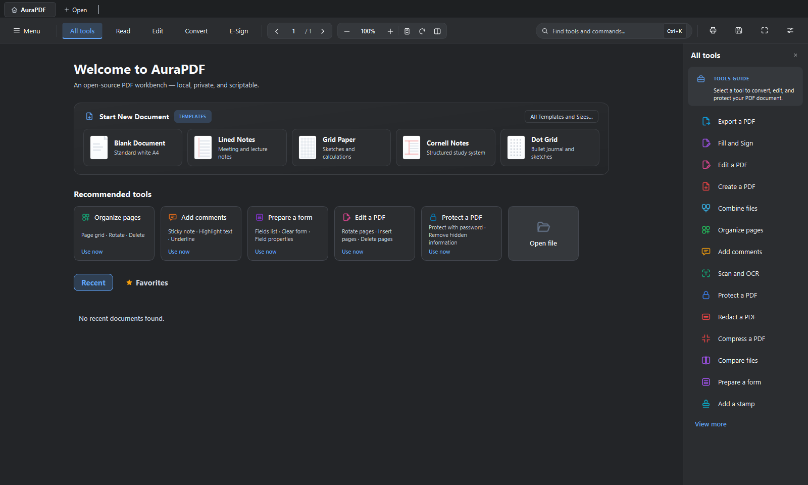
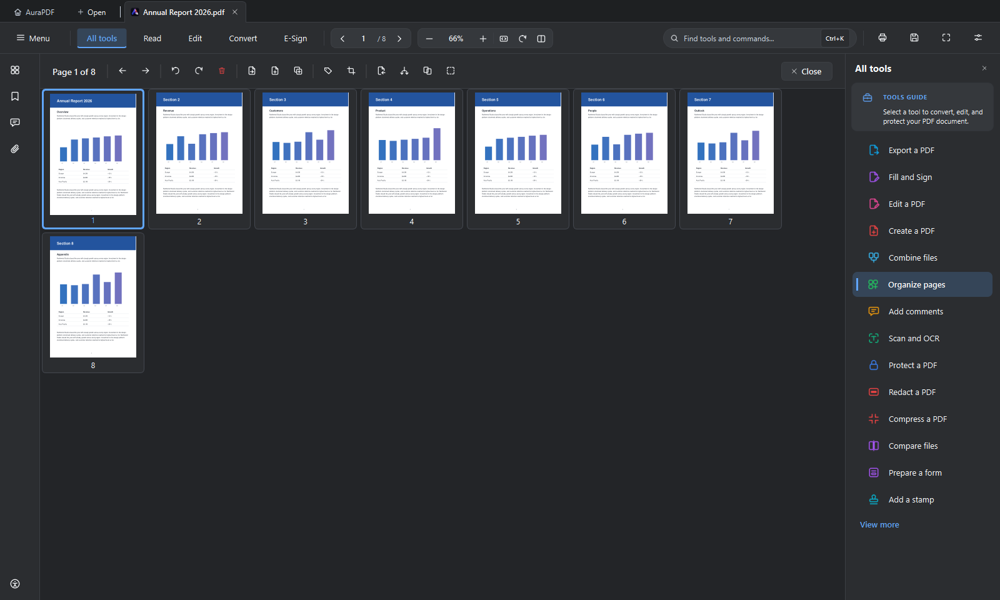
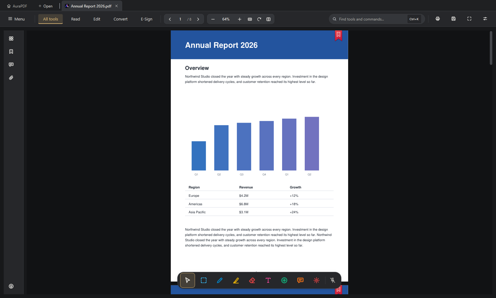
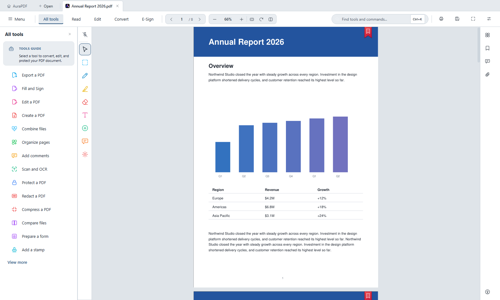
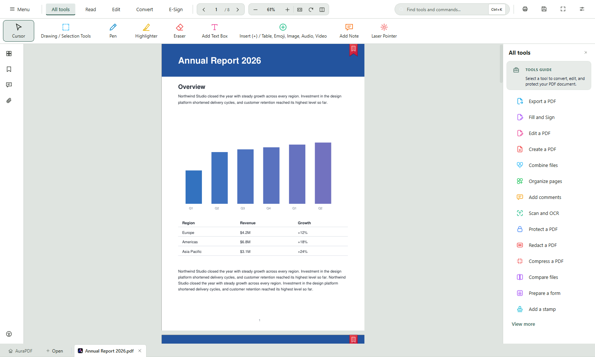
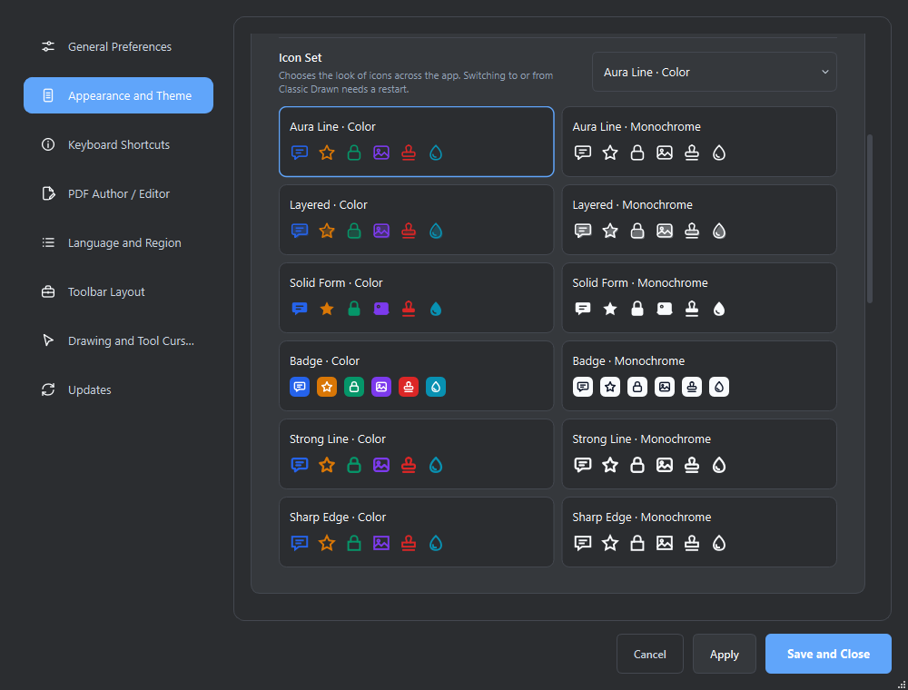

<p align="center">
  
</p>

<h1 align="center">AuraPDF Pro</h1>

<p align="center">
  A fast, private PDF workspace for Windows.<br>
  Read, edit, sign, organize and convert documents on your own machine.
</p>

<p align="center">
  <a href="https://github.com/furkanndev/AuraPDF/releases/latest"></a>
  
  
  
  <a href="LICENSE"></a>
</p>

<p align="center">
  <a href="https://github.com/furkanndev/AuraPDF/releases/latest"><strong>Download</strong></a>
  &nbsp;·&nbsp;
  <a href="#features">Features</a>
  &nbsp;·&nbsp;
  <a href="#development">Development</a>
  &nbsp;·&nbsp;
  <a href="#keyboard-shortcuts">Shortcuts</a>
</p>

<p align="center">
  
</p>

## Overview

AuraPDF Pro is a desktop PDF application built with Python, PyQt6 and PyMuPDF. It brings everyday reading and advanced document work into one tabbed workspace, available in Turkish and English.

| | |
| :--- | :--- |
| **Read** | Tabs, table of contents, search, reading modes and read-aloud |
| **Edit** | In-page text editing, annotations, drawing, images, tables and media |
| **Organize** | Merge, split, reorder, rotate, extract and insert pages |
| **Convert** | Word, Excel, PowerPoint, EPUB, HTML, RTF, text, EPS and images |
| **Secure** | Passwords, permanent redaction, signatures and stamps |

## Features

### Reading workspace

- Work across multiple documents with tabs, and reopen closed tabs with `Ctrl+Shift+T`.
- Compare two documents side by side in split view.
- Navigate with the table of contents, thumbnails, bookmarks and view history.
- Switch between day, dark and sepia reading modes.
- Keep frequent tools close with the floating tool palette.

### Home and templates

Start from blank, lined, grid, Cornell or dot grid templates, and return to recent and favorite documents.

<p align="center">
  
</p>

### Page organization

Manage a whole document from a thumbnail grid: reorder pages by dragging, rotate, delete, duplicate, extract or insert them.

<p align="center">
  
</p>

### Conversion and toolbox

- Export to `.docx`, `.xlsx`, `.pptx`, `.epub`, `.html`, `.rtf`, `.txt`, `.eps`, PNG and JPG.
- Merge and split PDFs, and compress them with presets.
- Run OCR to add a searchable text layer to scanned documents.

<p align="center">
  
</p>

### Editing and annotation

- Edit existing PDF text directly on the page.
- Highlight, underline, strike out, comment and add sticky notes.
- Draw with pens, highlighters and shapes.
- Add text boxes, images, GIFs, tables, audio and video.
- Add headers, footers, watermarks, backgrounds, links and Bates numbering.
- Permanently redact sensitive content.

<p align="center">
  
</p>

### Forms and signatures

Fill and create AcroForms, draw or type a signature, and place images, stamps and company seals.

### Interface styles

Choose the interface that suits your work. Each style has its own layout, typography, colors and motion, and animations can be turned off in Settings.

| Grafit | Atölye | Şerit |
| :---: | :---: | :---: |
|  |  |  |

The default Classic style offers Gray, Emerald, Purple, Crimson, Nord, Vice City and Apple themes, along with custom colors.

### Icon sets

Icons are drawn as vectors, so they stay sharp on scaled displays. Choose from six sets, each in color and monochrome, or switch to Classic Drawn.

<p align="center">
  
</p>

## Installation

Download the latest installer from the [Releases](https://github.com/furkanndev/AuraPDF/releases/latest) page and run it.

**Requirements:** 64-bit Windows 10 or 11, with 250 MB of free disk space. 4 GB of RAM is recommended.

> The installer is not code-signed yet, so Windows SmartScreen may show a warning.

## Keyboard shortcuts

| Shortcut | Action |
| :--- | :--- |
| `Ctrl+O` | Open a document |
| `Ctrl+S` / `Ctrl+Shift+S` | Save / Save as |
| `Ctrl+W` / `Ctrl+Shift+T` | Close tab / Reopen closed tab |
| `Ctrl+F` | Search in the document |
| `Ctrl+K` | Open the command palette |
| `Ctrl+D` | Document properties |
| `Ctrl++` / `Ctrl+-` | Zoom in / Zoom out |
| `Ctrl+0` / `Ctrl+2` | Fit page / Fit width |
| `Alt+Left` / `Alt+Right` | Previous / Next view |
| `F11` | Full screen |
| `F1` | Help and shortcuts |

Shortcuts can be changed in Settings.

## Development

### Run from source

Requires Python 3.10 or later.

```powershell
git clone https://github.com/furkanndev/AuraPDF.git
cd AuraPDF
python -m venv venv
.\venv\Scripts\Activate.ps1
pip install -r requirements.txt
python main.py
```

High-quality local text-to-speech is optional: `pip install -r requirements-tts.txt`

### Run the tests

```powershell
python -m unittest tests.test_static_guards tests.test_icon_sets
```

### Build the installer

Install [Inno Setup 6](https://jrsoftware.org/isinfo.php), then run:

```powershell
python build_setup.py
```

The installer is written to `Kurulum/Pro/`. Use `python build_setup.py --iss-only` to rebuild only the installer from an existing application build.

### Project structure

```text
AuraPDF/
├── assets/              Application icons and shell integration files
├── docs/screenshots/    README images
├── src/
│   ├── core/            Localization, updates, speech and shell integration
│   ├── document/        Tab documents, rendering and media items
│   └── ui/              Windows, dialogs, panels, icons and interface styles
├── tests/               Regression and static guard tests
├── tools/               Windows thumbnail provider
├── build_setup.py       Application and installer build script
├── installer.iss        Inno Setup script
└── main.py              Application entry point
```

### Branches

| Branch | Edition |
| :--- | :--- |
| `aurapdf_pro_windows` | Pro edition, with the full toolset |
| `aurapdf-basic-windows` | Basic edition, with core reading, annotation and page tools |

Project rules, including theming, localization and commit conventions, are in [AGENTS.md](AGENTS.md).

## License

Released under the [MIT License](LICENSE). Third-party components are listed in [THIRD_PARTY_NOTICES.txt](THIRD_PARTY_NOTICES.txt).
